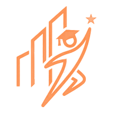
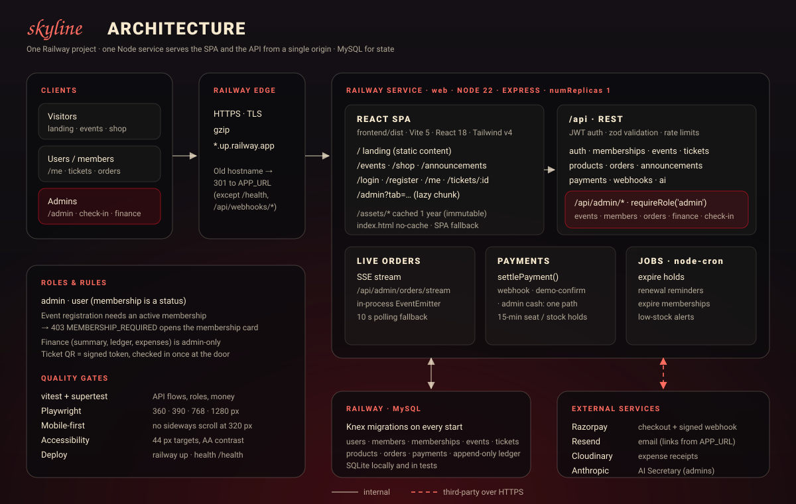
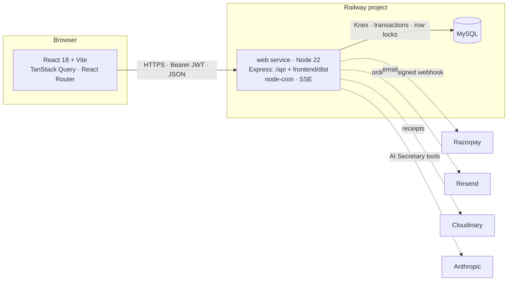

<div align="center">



# 🌅 Skyline Student Association

**Many students, one horizon.**
The club's website and operations platform: events with member and non-member ticketing, memberships and dues, a merch shop, fundraisers, announcements, door check-in and an append-only ledger. One TypeScript codebase, one mobile-first UI, one deploy on Railway.

[](https://skyline-student-association.up.railway.app)
[](https://skyline-student-association.up.railway.app)
[](https://skyline-student-association.up.railway.app/api/health)
[](#-testing--quality)
[](https://github.com/vardhan23v/skyline_student-association/commits/main)

[](https://react.dev/)
[](https://vitejs.dev/)
[](https://www.typescriptlang.org/)
[](https://tailwindcss.com/)
[](https://tanstack.com/query)
[](https://www.framer.com/motion/)
[](https://nodejs.org/)
[](https://expressjs.com/)
[](https://www.mysql.com/)
[](https://knexjs.org/)
[](https://zod.dev/)
[](https://vitest.dev/)
[](https://playwright.dev/)
[](https://railway.com/)
[](https://razorpay.com/)

[Live demo](#-live-demo) · [Quick start](#-quick-start) · [Architecture](#-architecture) · [API](#-api-reference) · [Domain rules](#-domain-rules) · [Deployment](#%EF%B8%8F-deployment) · [Runbook](#-operations-runbook) · [Contributing](#-contributing)

</div>

---

## ✨ Live demo

| | URL | Notes |
|---|---|---|
| **App** | https://skyline-student-association.up.railway.app | React SPA and API on one origin, served by one Express process |
| **API** | https://skyline-student-association.up.railway.app/api | [`/api/health`](https://skyline-student-association.up.railway.app/api/health) returns JSON, `/health` a plain `ok` for Railway |
| **Database** | Railway MySQL | Private network only; Knex migrations run on every boot |
| **Payments** | Demo mode | `DEMO_PAYMENTS=true`: every checkout shows **Pay (demo)** and settles through the real server path. Razorpay is wired and switches on with keys |

Sign in with a demo account:

| Role | Email | Password | State |
|---|---|---|---|
| Admin | `admin@skyline.edu` | `Admin@123` | Full control |
| Admin | `core@skyline.edu` | `Core@123` | Second admin, for splitting fundraiser tasks (fresh seeds only) |
| User · member | `member@skyline.edu` | `Member@123` | Active until 30 June; tickets for CodeStorm 2026 and the Spring Gala; three orders |
| User · non-member | `student@skyline.edu` | `Student@123` | No membership; can join or register at non-member prices |
| User · lapsed | `lapsed@skyline.edu` | `Lapsed@123` | Membership ended 30 days ago; listed under "Who owes what" (fresh seeds only) |

> [!WARNING]
> These passwords are public. Rotate them or delete the accounts before real use. Real students already use the live site.

---

## 🧭 What's inside

- **Event reminders and calendars:** a "Tomorrow" email the day before, Add to calendar (.ics) and Google Calendar on every ticket, and an Up next card on the account page.
- **Events and ticketing:** member and non-member prices, members-only events, capacity under a row lock, 15-minute seat holds, signed QR tickets, cancellation with an automatic ledger reversal. A non-member can **pay the non-member price** or **join and pay the member price** in one flow.
- **Walk-in sign-up:** an admin signs a student up at the campus table, records cash dues in the same step and the student gets an email to set their password.
- **Memberships and dues:** buy or renew online (renewal opens 30 days before expiry), cash dues recorded by admins, dues history, expiry dates set by admins, reminder emails 14 days before expiry and on the day, and a membership QR.
- **Door check-in:** rear-camera scanner with a ✓/✗ banner, vibration and a live count; a **Membership** mode verifies member QRs or student IDs at the door.
- **Merch shop:** sizes with live stock, member pricing, cart sheet, reserved stock while paying, low-stock alerts, and a **live orders** feed for admins over Server-Sent Events.
- **Fundraisers:** split into tasks assigned to admins with due dates; raised and spent come from the ledger, never from a typed number; overdue flags and an **on track / behind** health badge.
- **Who owes what (admin-only):** memberships due, unpaid orders and tickets, and reimbursements the club owes, with one-click reminders.
- **Finance (admin-only):** append-only ledger with reversals and CSV export, expense submission with receipts, a two-person review rule, and rule-based anomaly flags.
- **Announcements:** public or members-only posts, mailed to the list.
- **Share to WhatsApp:** after publishing, one tap opens WhatsApp with a formatted message (or the phone's share sheet) so the same post goes to every group; events share with date, venue, both prices and the register link. Links land on the exact post (`/announcements#a-<id>`). No WhatsApp API or phone numbers.
- **AI Secretary (admin-only):** answers from live data through role-filtered tools, with no text-to-SQL; any action it proposes needs explicit confirmation.
- **Landing page from the database:** upcoming and past events, the stats and merch prices are read live from the API, so the homepage always matches what admins publish.
- **UI:** one design system on every page (landing, auth, account, shop, admin), mobile-first from 320 px, card-mode tables, bottom sheets, `prefers-reduced-motion` safe.

---

## 🚀 Quick start

**Prerequisites:** Node 22, npm. Google Chrome only for the Playwright checks. No database server needed: SQLite is used locally.

```bash
git clone https://github.com/vardhan23v/skyline_student-association.git
cd skyline_student-association
npm --prefix backend install && npm --prefix frontend install

cp backend/.env.example backend/.env           # leave DATABASE_URL empty → SQLite at backend/dev.sqlite
echo "DEMO_PAYMENTS=true" >> backend/.env       # checkouts without Razorpay

npm --prefix backend run migrate               # Knex migrations
npm --prefix backend run seed                  # demo club: 4 accounts, 5 events, 4 products, 2 fundraisers
npm run dev:backend                            # API  → http://localhost:3000/api
npm run dev:frontend                           # SPA  → http://localhost:5173 (proxies /api)
```

Open http://localhost:5173 and sign in with a [demo account](#-live-demo).

| Script | What it does |
|---|---|
| `npm run dev:backend` / `npm run dev:frontend` | `tsx watch` API on :3000 · Vite on :5173 |
| `npm run build` (root) | Clean installs, `tsc -b && vite build` for the SPA, `tsc` for the API. What Railway runs |
| `npm start` (root) | Migrate → seed if `ALLOW_DEMO_SEED=true` → `node backend/dist/server.js` |
| `npm test` | 143 vitest + supertest API tests on an in-memory SQLite database |
| `npm --prefix frontend test` | Unit tests for `src/lib` (share-message formatting) |
| `npm --prefix backend run typecheck` · `npm --prefix frontend run typecheck` | Strict type checks |
| `npm --prefix backend run migrate` · `migrate:rollback` · `seed` | Schema and demo data for whatever `DATABASE_URL` points at |
| `npm --prefix backend run job <name>` | Run one scheduled job now: `eventReminders`, `renewalReminders`, `expireMemberships`, `expireHolds`, `lowStock` |
| `npm --prefix frontend run test:responsive` | Playwright at 360 · 390 · 768 · 1280 px against a running server |
| `npm --prefix frontend run media:prepare` | Phone-sized copies of the landing photos |

---

## 🏗 Architecture

<p align="center">
  
</p>



**Backend layering:** `routes → middleware (auth · requireRole · zod validate · rate limit) → service (business rules, Knex) → MySQL`. Each feature is a module under `backend/src/modules/<name>/` with `routes.ts`, `service.ts` and `schemas.ts`.

**Frontend:** pages per area (`public`, `member`, `admin`), one `AuthContext`, a typed `api()` fetch wrapper that turns `403 MEMBERSHIP_REQUIRED` into the membership card, TanStack Query for server state, and a shared kit (`DataTable` with phone card mode, `Modal` as a bottom sheet, `PageHeader`, `StatusBadge`, `MetricCard`, `Toast`).

### Repository layout

```
.
├── backend/
│   ├── src/
│   │   ├── app.ts                 # security headers, /api router, SPA + asset caching
│   │   ├── server.ts              # listen + scheduled jobs
│   │   ├── config/                # env (zod-validated), db, knexfile
│   │   ├── middleware/            # auth (JWT, roles), canonicalHost (301), validate, errors
│   │   ├── modules/               # admin · ai · announcements · auth · events · finance
│   │   │                          # fundraisers · memberships · merchandise · payments
│   │   ├── jobs/                  # node-cron: holds, reminders, expiry, anomaly scan, low stock
│   │   └── lib/                   # dates (club time zone), email, QR signing, storage, logger
│   └── test/                      # vitest + supertest suites
├── database/
│   ├── migrations/                # Knex migrations, applied on every boot
│   └── seeds/001_demo.ts          # demo club (wipes the database)
├── frontend/
│   ├── src/
│   │   ├── pages/                 # public · member · admin
│   │   ├── components/            # shared UI and landing/
│   │   ├── api/                   # fetch wrapper and response types
│   │   └── index.css              # design tokens and component layer
│   ├── public/                    # brand, fonts, media, og-image
│   └── tests/                     # Playwright responsive checks
├── docs/                          # api.md · architecture.md · design.md · architecture.svg
├── package.json                   # root build/start used by Railway
└── railway.json                   # build, start, health check
```

### Design decisions

| Decision | Why |
|---|---|
| One Express process serves the SPA and `/api` | One origin: no CORS, no API URL to configure, one deploy. `/assets/*` is cached immutable for a year and `index.html` is `no-cache`, so a deploy lands on the next page load. |
| Two roles; membership is a **status** | `admin` and `user` only. A member is a user with an active `memberships` row, so lapsing or renewing never touches permissions. |
| One `settlePayment()` path | Razorpay's webhook, the demo checkout and admin cash all confirm tickets, orders and memberships the same way and write exactly one ledger row. |
| Append-only ledger, derived reports | Balance, event revenue and fundraiser progress are sums over `ledger_entries`; mistakes are fixed with reversing entries, never edits. |
| Seat and stock holds under a row lock | `SELECT … FOR UPDATE` on the event row plus a pending ticket holds the seat; the gateway call happens after the lock is released so a slow provider can't stall an event. |
| Club time zone for every calendar rule | Expiry, overdue tasks, days left and the cron schedules use `APP_TIMEZONE` (IST), not the UTC date, which is a day behind before 05:30. |
| In-process SSE and cron, `numReplicas: 1` | Enough for one club; scaling out needs Redis pub/sub and a job lock. |
| Demo payments behind a flag | The full flow is demoable without a merchant account. With Razorpay keys set, demo confirm is refused. |
| SQLite locally and in tests | Zero setup and fast suites; migrations handle the MySQL/SQLite differences (enum rebuilds, booleans, date strings). |

---

## ⚙️ Configuration

Read and validated in [`backend/src/config/env.ts`](backend/src/config/env.ts); production refuses to boot without the required ones.

| Variable | Default | Purpose |
|---|---|---|
| `DATABASE_URL` | empty → SQLite | `mysql://…`; `${{MySQL.MYSQL_URL}}` on Railway |
| `NODE_ENV` | `development` | `production` on Railway |
| `APP_URL` | `http://localhost:$PORT` | **Required in prod.** Public origin, no trailing slash. Builds email links; other hostnames get a 301 to it |
| `VITE_APP_URL` | — | Build time. Canonical and Open Graph URLs in `index.html` |
| `JWT_SECRET` / `QR_SECRET` | dev placeholders | **Required in prod**, 16+ / 8+ chars and different from each other. JWTs last 24 h |
| `DEMO_PAYMENTS` | `false` | `true` enables **Pay (demo)** while no Razorpay keys are set |
| `RAZORPAY_KEY_ID` / `RAZORPAY_KEY_SECRET` / `PAYMENT_WEBHOOK_SECRET` | — | Live payments. Without the webhook secret every webhook is rejected |
| `PENDING_HOLD_MINUTES` | `15` | How long an unpaid seat or stock reservation is held |
| `MEMBERSHIP_YEAR_END` | `06-30` | Academic year end (`MM-DD`); memberships run to it |
| `APP_TIMEZONE` | `Asia/Kolkata` | The club calendar for expiry, reminders and cron |
| `ALLOW_DEMO_SEED` / `SEED_FORCE` | `false` | Seed on boot / wipe a non-empty database for one boot |
| `RESEND_API_KEY` · `EMAIL_FROM` | — · `ssa@example.com` | Email; without a key, emails are logged |
| `CLOUDINARY_URL` | — | Receipt storage; inline otherwise |
| `LLM_API_KEY` | — | AI Secretary model; a keyword router over the same tools otherwise |
| `PORT` | `3000` | Railway injects it; don't set it there |

---

## 📡 API reference

Base path `/api`. JSON in and out; auth is `Authorization: Bearer <JWT>`. Errors are `{ error, message, code }`, and `code` is stable. Full route list with request and response shapes: [`docs/api.md`](docs/api.md).

<details>
<summary><b>Auth and account</b></summary>

| Method | Path | Role | Notes |
|---|---|---|---|
| POST | `/auth/register` · `/auth/login` | public | Always role `user`; optional `student_id` creates the member profile |
| POST | `/auth/forgot-password` · `/auth/reset-password` | public | One-time links (SHA-256 stored, 60 min reset / 72 h setup); same answer whether or not the email exists |
| GET | `/me` | user | Account, membership (`is_member`, `days_left`, `can_renew`, `dues`), member QR, tickets |
| GET | `/membership/info` | public | Price, benefits, valid until |
| GET | `/stats` | public | Landing-page counts from the database (events hosted, members, students, tickets); no money; cached 60 s |
| POST | `/memberships` | user | Start or renew (within 30 days of expiry); returns a checkout |
| POST | `/payments/demo-confirm/:paymentId` | payer | Demo mode only; same settle path as the webhook |
</details>

<details>
<summary><b>Events and tickets</b></summary>

| Method | Path | Role | Notes |
|---|---|---|---|
| GET | `/events` · `/events/:id` | public | `member_price`, `non_member_price`, `members_only`, `price_for_you`, `seats_left`, `viewer` |
| POST | `/events/:id/register` | user | Member → member ticket at `member_price`; others → non-member ticket, or 403 on members-only events |
| DELETE | `/events/:id/register` | holder | Cancel before start; paid tickets get a ledger reversal |
| GET | `/tickets` · `/tickets/:id` | holder / admin | With the QR image |
| GET | `/tickets/:id/calendar.ics` · `/me/upcoming` | holder | Add-to-calendar file; my next events, soonest first |
</details>

<details>
<summary><b>Shop and announcements</b></summary>

| Method | Path | Role | Notes |
|---|---|---|---|
| GET | `/products` | public | Variants with `available` and `price_for_you` |
| POST | `/orders` | user | Reserves stock, snapshots prices, returns a checkout |
| GET | `/orders/mine` · `/orders/:id` | owner / admin | |
| GET | `/announcements` | public | Members-only posts for members and admins |
</details>

<details>
<summary><b>Admin</b> — <code>/api/admin/*</code>, one <code>requireRole('admin')</code> on the router</summary>

| Area | Routes |
|---|---|
| Overview | `GET /overview` (members, registrations, orders today, balance, owed to / by the club, active and behind fundraisers) · `GET /users?role=admin` |
| Who owes what | `GET /dues` · `POST /dues/remind` (once per person per 24 h) |
| Events | `GET/POST /events` · `GET/PATCH /events/:id` · `GET /events/:id/report` (member / non-member split) · `GET /events/:id/registrations` · `POST /checkin` |
| Members | `GET /members` · `POST /members/walk-in` · `GET /members/:id/verify` · `GET /members/:id/dues` · `PATCH /members/:id/membership` · `POST /members/:id/remind` · `POST /members/:id/cash-payment` |
| Shop | `GET/POST /products` · `PATCH /products/:id` · `PATCH /variants/:id` · `GET /orders` · `GET /orders/stream` (SSE) · `PATCH /orders/:id` |
| Fundraisers | `GET/POST /fundraisers` · `GET/PATCH /fundraisers/:id` · `GET/POST /fundraisers/:id/tasks` · `POST /fundraisers/:id/cash-income` · `GET /tasks` · `PATCH /tasks/:id` |
| Finance | `GET /finance/ledger` (`format=csv`) · `POST /finance/ledger/:id/reverse` · `POST/GET /expenses` · `GET /expenses/:id` · `PATCH /expenses/:id/review` · `PATCH /expenses/:id/pay` |
| Content | `POST /announcements` |

Also admin-only, outside `/api/admin`: `GET /api/finance/summary`, and the AI Secretary at `POST /api/ai/ask` and `POST /api/ai/confirm/:proposalId`.
</details>

**Error codes:** `BAD_REQUEST` 400 · `UNAUTHORIZED` 401 · `FORBIDDEN` 403 · `MEMBERSHIP_REQUIRED` 403 (with the offer) · `NOT_FOUND` 404 · `ALREADY_REGISTERED` · `SOLD_OUT` · `ALREADY_MEMBER` · `INSUFFICIENT_STOCK` · `INVALID_TRANSITION` 409 · `REGISTRATION_NOT_OPEN` · `REGISTRATION_CLOSED` · `PROFILE_REQUIRED` · `INVALID_ASSIGNEE` · `INVALID_TOKEN` 400.
**Rate limits:** auth 30 / 15 min, registration, orders and memberships 30 / 15 min per IP, check-in 120 / min.

---

## 📐 Domain rules

### Roles

| Capability | Visitor | User | Member | Admin |
|---|:--:|:--:|:--:|:--:|
| Browse events, shop, announcements | ✅ | ✅ | ✅ | ✅ |
| Register for open events (non-member price) | — | ✅ | — | ✅ |
| Member prices, members-only events and posts | — | — | ✅ | ✅ |
| Buy and renew a membership, order merch | — | ✅ | ✅ | ✅ |
| Check-in, members, products, orders, fundraisers, announcements | — | — | — | ✅ |
| Finance, ledger, expenses, AI Secretary | — | — | — | ✅ |

Every `/api/admin/*` route sits behind one guard on the router, so a new admin route can't be added without it. Services check ownership for tickets, orders and memberships; the client is never trusted.

### Ticket pricing
- Members pay `member_price`; everyone else `non_member_price`. Membership is re-checked under the event lock.
- `members_only` events answer non-members with **403 `MEMBERSHIP_REQUIRED`** and the offer; the UI opens the membership card and resumes the registration after payment.
- If a non-member joins while a seat is held, registering again re-prices the same ticket and drops the stale checkout.
- The event report splits registered, checked in and ticket revenue by member and non-member.

### Memberships
- A membership runs to the academic year end (`MEMBERSHIP_YEAR_END`). **Current** is the period covering today; renewals start the day after the latest paid period.
- Online renewal opens 30 days before expiry; reminders go out 14 days before and on the day, skipping members who already renewed.

### Money
- Every rupee in or out is one `ledger_entries` row, idempotent on `(source_type, source_id)`. Corrections are reversing entries; reversing twice is a 409.
- Expenses need a different admin to review them; anomaly rules flag duplicate receipts, possible resubmissions, missing receipts, unusually high amounts and over-budget spend.

### Fundraiser health
First match wins: `completed` / `cancelled` (status) → `no_data` (no target and no tasks) → `behind` (any task overdue, or the end date passed with raised < target) → `on_track`. Progress is `raised / target`, uncapped; the bar caps at 100 %.

---

## 🗄 Data model

Knex migrations in [`database/migrations/`](database/migrations/) run on every boot (MySQL in production, SQLite locally and in tests).

`users` · `members` · `memberships` · `payments` · `events` *(member / non-member price, members_only)* · `tickets` *(unique event_id, holder_user_id)* · `announcements` · `products` · `product_variants` *(unique product_id, size)* · `orders` · `order_items` · `fundraisers` · `tasks` · `expenses` · `ledger_entries` *(append-only, unique source)* · `cash_receipts` · `webhook_events` · `ai_audit` · `ai_proposals` · `audit_logs` · `user_preferences`

Conventions: money is `DECIMAL(12,2)`; calendar dates are `DATE` in the club time zone; enums change through reversible migrations (MySQL `MODIFY`, SQLite table rebuilds); nothing financial is ever deleted.

### Scheduled jobs (`node-cron`, club time zone)

| Schedule | Job |
|---|---|
| every 5 min | Release expired seat and stock holds |
| 00:05 | Expire lapsed memberships |
| 01:30 | Re-scan submitted expenses for anomalies |
| 02:00 | Low-stock alert |
| 08:00 | Renewal reminders |
| hourly | Event reminders: confirmed tickets for events 23–25 h away, once per ticket |

---

## ☁️ Deployment

One Railway project with two services, **web** (this repo) and **MySQL**. `railway.json` runs the root `npm run build`, then `npm start`: migrations, the demo seed if enabled, then the server. Health check: `/health`.

```bash
railway up --service web          # GitHub isn't connected to Railway, so a push alone doesn't deploy
```

### Domain
Live at **`https://skyline-student-association.up.railway.app`**. `APP_URL` and `VITE_APP_URL` point at it, and any other hostname gets a 301 (except `/health`, `/api/health` and `/api/webhooks/*`). To move to a custom domain:

```bash
railway variables --service web --set "APP_URL=https://<domain>" --set "VITE_APP_URL=https://<domain>" --skip-deploys
railway up --service web
```

Then update the Razorpay webhook (`https://<domain>/api/webhooks/payment`), the Resend sender domain and the repo's Website field.

### Going live with payments
1. Add `RAZORPAY_KEY_ID`, `RAZORPAY_KEY_SECRET` and `PAYMENT_WEBHOOK_SECRET` on the `web` service.
2. Point the Razorpay webhook at `/api/webhooks/payment`.
3. Remove `DEMO_PAYMENTS` and redeploy.

---

## 🛠 Operations runbook

| Symptom | Likely cause | Fix |
|---|---|---|
| Deploy crashes: `Missing required setting(s) in production: APP_URL` | `APP_URL` (or `JWT_SECRET` / `QR_SECRET`) not set | Set it on the `web` service, redeploy |
| A link lands on Railway's *Not Found* page | Browser cached the old domain's 301 | Clear cached images and files, or open in Incognito; `curl -I` the URL to confirm |
| `knex: migration directory is corrupt` | A migration file was renamed or deleted after it ran, e.g. Finder's `… 2.ts` copies | Restore the file, or delete its row from `knex_migrations` |
| Build fails on files ending in ` 2.ts` | Duplicate files from a copy; `railway up` uploads untracked files too | Delete them: `git ls-files --others --exclude-standard` |
| `[seed] skipped: database already has users` | Expected: the seed never wipes a live database | Use the admin UI; `SEED_FORCE=true` for one boot only if you mean to wipe |
| Checkout says the demo route is missing | `DEMO_PAYMENTS` off, or Razorpay keys are set | Set `DEMO_PAYMENTS=true` with no keys, or finish the Razorpay setup |
| Every Razorpay webhook is rejected | `PAYMENT_WEBHOOK_SECRET` unset | Set it to the dashboard's webhook secret |
| Emails don't arrive | `RESEND_API_KEY` unset; they're logged instead | Add the key and a verified `EMAIL_FROM` |
| Non-members can't register for an event | The event is `members_only` (every event that existed before pricing returned) | Admin → Events → Edit: set the non-member price, untick **Members only** |
| A date is a day off | Something used the UTC date instead of the club calendar | Use `todayYmd()` / `addDaysYmd()` from `backend/src/lib/dates.ts` |

---

## 🧪 Testing & quality

```bash
npm test                                         # 143 API tests, in-memory SQLite
npm --prefix frontend test                       # share-message unit tests
npm --prefix backend run typecheck               # strict, API
npm --prefix frontend run typecheck              # strict, SPA
npm run build && DEMO_PAYMENTS=true ALLOW_DEMO_SEED=true PORT=8099 npm start   # then:
npm --prefix frontend run test:responsive        # Playwright, 4 viewports
```

| Area | How it's held |
|---|---|
| Correctness | Tests target where money, seats and permissions go wrong: pricing, holds and capacity races, settle idempotency, ledger reversals, the admin guard on every route, fundraiser health, migrations up and down |
| Responsive | Playwright at 360 · 390 · 768 · 1280 px fails on horizontal scroll or a control under 44 px |
| Accessibility | AA contrast on every surface, focus traps in sheets, announced form errors, status never colour-only. Lighthouse accessibility 100 |
| Performance | Admin, scanner, charts and motion in separate chunks; about 160 KB gzipped JS on public pages; phone-sized images; CLS 0 |
| Security | helmet, zod on every input, rate limits, bcrypt, signed QR tokens and webhooks, admin-only finance and AI, no stack traces in responses |

---

## 🎨 Design system

One token set across every page ([`frontend/src/index.css`](frontend/src/index.css)); details in [`docs/design.md`](docs/design.md).

| Token | Value | Use |
|---|---|---|
| Midnight | `#0B0B0D` | Base background |
| Cream | `#F6E9CE` | All text (70 % / 60 % for secondary and tertiary) |
| Crimson | `#C1121F` | Fills, focus rings, active states; never text |
| Flame | `#FF6B5E` | Red text and the script accent words |

- **Type:** Open Sauce Sans, self-hosted. Uppercase headings paired with one lowercase script word, e.g. *fund* RAISERS.
- **Surfaces:** glass panels over crossfading photographic backgrounds with embers and a heat glow.
- **Motion:** framer-motion and Lenis on desktop, lighter on phones, off under `prefers-reduced-motion`.
- **Mobile:** hamburger sheet, sticky admin tab strip, card-mode tables, bottom-sheet dialogs, sticky action bars with safe-area insets.

---

## 🤝 Contributing

1. Branch from `main`; keep each change to one feature or fix.
2. Conventional commits: `feat:`, `fix:`, `test:`, `docs:`, `refactor:`, `chore:`.
3. Backend behaviour lives in `modules/<name>/service.ts` with the route as a thin adapter; add a test whenever money, dates, seats or permissions are involved.
4. Schema changes are new Knex migrations with a working `down()`, tested on SQLite; never edit one that has run in production.
5. `npm test` and both type checks must pass before deploying.
6. Never commit `.env` files or secrets.

### Roadmap
- [x] Two roles, membership as a status, one admin dashboard
- [x] Mobile-first UI from 320 px, one design system
- [x] Dues tracking, renewals, reminders and membership checks at the door
- [x] Fundraisers with tasks and health
- [x] Member and non-member ticket pricing
- [ ] Razorpay live keys; switch off `DEMO_PAYMENTS`
- [ ] Rotate or remove the public demo accounts
- [ ] Prerender the landing and login shells for a sub-3 s cold LCP

---

## 📚 Documentation

| Document | What's in it |
|---|---|
| [`docs/api.md`](docs/api.md) | Every route with its role and purpose, error codes, the checkout flow, migrations and later changes |
| [`docs/architecture.md`](docs/architecture.md) | Product specification, data model, money rules, fundraiser health |
| [`docs/design.md`](docs/design.md) | Tokens, type, surfaces, motion and the responsive system |
| [`frontend/public/media/README.md`](frontend/public/media/README.md) | Landing photos and videos: sizes, sources, replacing them |

---

## 📄 License

No license file has been added yet, so all rights are reserved by default. Built for the Skyline Student Association; review privacy requirements before storing more student data.

<div align="center">
<br />
<sub>Skyline Student Association · Beyond the Bell.</sub>
</div>
