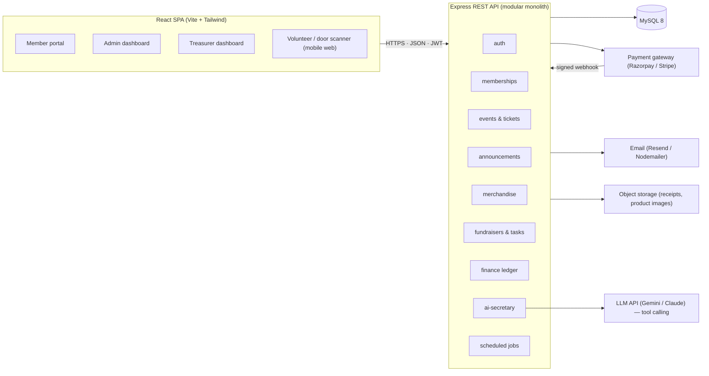
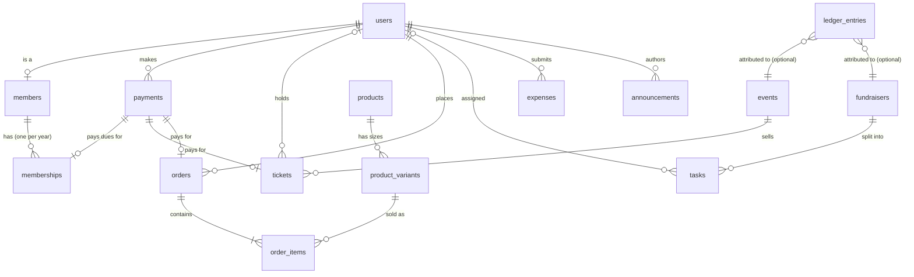

# Student Organization System — Architecture

> **Superseded in part (Phase 1).** The four roles below (member, volunteer, admin, treasurer) were replaced by two: `admin` and `user`, with membership as a status. Volunteer and treasurer duties now belong to admins, and admin routes live under `/api/admin/*`. Event tickets are members-only registrations. The current routes, roles and error codes are in [`api.md`](api.md); the data model and money rules here still apply.

**Target:** Skyline Student Association (SSA). One platform for memberships, event ticketing, announcements, merchandise, fundraisers/volunteer tasks, and club finances.
**Style:** Modular monolith, 3-tier (React SPA → Express REST API → MySQL), deployed as one Node service + MySQL on Railway, with payment, email, object-storage and LLM providers as external services.

---

## 1. Problem → module map

Every module below exists because one scene in the problem statement needs it.

| Scene | How it runs today | Module | Must-have capability |
|---|---|---|---|
| A new student joins | Spreadsheet | **Memberships** | Register, record dues, expiry date, renewal reminder, verify membership at an event, member pricing on tickets/merch |
| Spring gala tickets | Cash at the door | **Events & Ticketing** | Online sale, member vs non-member price, seat cap, QR check-in in seconds without a list, attendance + revenue after the event |
| Announcing the next meeting | One-by-one WhatsApp | **Announcements** | One post → website + mailing list, timestamped archive |
| Ordering hoodies | Paper + chasing payment | **Merchandise** | Products with size variants, live stock, online order + payment, fulfilment status |
| Planning a fundraiser | Group chat | **Fundraisers & Tasks** | Tasks with owner + deadline, status board, progress vs target |
| Treasurer closes the books | Notebook + receipts | **Finance** | Append-only ledger of every ₹ in and out, reimbursements with receipts, balance, reports anyone can read |

Cross-cutting: **Auth & roles**, **Notifications/jobs**, and (optional, hackathon differentiator) **AI Secretary** + **Anomaly flags**.

---

## 2. System context



**Why a modular monolith:** one deployable, one database, one transaction scope. Ticket capacity, stock reservation and ledger writes all need atomic multi-table transactions; microservices would make that harder for no benefit at this scale (one club, hundreds of members).

**Module boundary rule:** each module owns its tables and exposes a service interface. Other modules call the service, never the tables directly. Example: `events.confirmTicket()` calls `finance.recordEntry()`; it does not `INSERT INTO ledger_entries`.

---

## 3. Technology stack

| Layer | Choice | Why |
|---|---|---|
| Frontend | React 18 + Vite, React Router, TanStack Query | Fast dev loop, cached server state per page |
| Styling | Tailwind CSS | Responsive dashboards without a design system |
| QR | `qrcode` (generate), `html5-qrcode` (scan via phone camera) | No native app needed at the door |
| Backend | Node 20 + Express 4, TypeScript | Shared types with frontend |
| Validation | zod | Schema-validate every request body/param |
| DB | MySQL 8, `mysql2` + Knex (query builder + migrations) | Relational integrity, `SELECT … FOR UPDATE` for capacity/stock |
| Auth | JWT (HS256) + bcrypt | Stateless API, role in token |
| Payments | Razorpay (INR) — Stripe as alternative | Hosted checkout; webhook confirms payment |
| Email | Resend (or Nodemailer + SMTP) | Announcements, reminders, tickets |
| Files | Cloudinary (or S3-compatible) | Receipts and product images off the API server |
| Jobs | `node-cron` inside the API process (single instance) | Reminders, pending-order expiry, nightly checks |
| AI | Gemini / Claude function-calling | Secretary answers from tool results, not free text |
| Hosting | Railway only — one Node service serves the API **and** the built SPA, plus a Railway MySQL plugin | Single deploy, same origin (no CORS), one domain for QR links and webhooks |

---

## 4. Data model

### 4.1 Entity relationships



### 4.2 Tables

Types abbreviated; all tables have `id BIGINT PK AUTO_INCREMENT`, `created_at`, `updated_at`.

| Table | Columns (key ones) | Constraints / notes |
|---|---|---|
| `users` | name, email, password_hash, role ENUM(member, volunteer, admin, treasurer), is_active | `UNIQUE(email)`. Role is a single value; admin ⊇ volunteer rights. |
| `members` | user_id, student_id, phone, joined_at | `UNIQUE(user_id)`, `UNIQUE(student_id)` |
| `memberships` | member_id, start_date, expiry_date, status ENUM(pending, active, expired), payment_id, reminder_sent_at | One row per membership year. "Current" = latest row with `status='active' AND expiry_date >= today`. |
| `payments` | user_id, amount, currency, purpose ENUM(dues, ticket, merch), reference_type, reference_id, provider ENUM(razorpay, stripe, cash), provider_order_id, provider_payment_id, status ENUM(pending, paid, failed, refunded), paid_at | `UNIQUE(provider_payment_id)` makes webhook retries idempotent. `provider='cash'` for door/table sales entered by treasurer. |
| `events` | title, description, starts_at, venue, capacity, member_price, non_member_price, sales_open_at, sales_close_at, status ENUM(draft, published, closed) | Capacity enforced in code under row lock (see §6.1). |
| `tickets` | event_id, holder_user_id (nullable), holder_name, holder_email, ticket_type ENUM(member, non_member), price, payment_id, qr_token, status ENUM(pending, confirmed, checked_in, cancelled), checked_in_at, checked_in_by | `UNIQUE(qr_token)`. Attendance = `COUNT(status='checked_in')`; no separate registrations table. Non-members buy with name+email only. |
| `announcements` | title, body, author_id, audience ENUM(all, members), published_at, email_sent_at, email_recipient_count | Archive is the table itself; nothing is editable after `published_at` (append a correction instead). |
| `products` | name, description, image_url, is_active | |
| `product_variants` | product_id, size, price, member_price, stock, reserved | `UNIQUE(product_id, size)`. Available = `stock - reserved`. |
| `orders` | user_id, subtotal, total, payment_id, status ENUM(pending, paid, fulfilled, cancelled), fulfilled_at | |
| `order_items` | order_id, variant_id, qty, unit_price | Price snapshot at order time. |
| `fundraisers` | name, description, target_amount, starts_on, ends_on, status ENUM(planning, active, closed) | Raised so far = ledger sum, not a stored column. |
| `tasks` | fundraiser_id, title, assignee_id (nullable), due_on, status ENUM(todo, doing, done), done_at | Overdue = `due_on < today AND status != 'done'`. |
| `expenses` | submitted_by, event_id (nullable), fundraiser_id (nullable), amount, category, description, receipt_url, receipt_hash, status ENUM(submitted, approved, rejected, paid), reviewed_by, reviewed_at, review_note, flags JSON | `receipt_hash` = SHA-256 of the uploaded file; duplicates are a flag. |
| `ledger_entries` | direction ENUM(in, out), amount, category ENUM(dues, ticket, merch, fundraiser, reimbursement, other), source_type, source_id, event_id (nullable), fundraiser_id (nullable), memo, entered_by, occurred_at | **Append-only.** `UNIQUE(source_type, source_id)` guarantees one entry per paid payment / paid expense. Balance = `SUM(in) - SUM(out)`. Corrections are reversing entries, never updates. |
| `ai_audit` | user_id, prompt, tool_calls JSON, response, proposal_id, confirmed_at | Every secretary interaction is logged. |

### 4.3 Invariants the database + service layer must hold

1. A ticket, order or membership is `confirmed/paid/active` **only** after a verified payment webhook (or a treasurer-entered cash payment).
2. `COUNT(tickets WHERE event_id=? AND status IN (pending, confirmed, checked_in)) <= events.capacity` — enforced under `SELECT … FOR UPDATE` on the event row.
3. `product_variants.reserved <= stock` — enforced with a conditional `UPDATE … WHERE stock - reserved >= :qty` and checking affected rows.
4. Every `payments.status='paid'` row has exactly one `ledger_entries` row (`source_type='payment'`); every `expenses.status='paid'` row has exactly one (`source_type='expense'`).
5. Pending tickets/orders older than 15 minutes are cancelled by a job, releasing seats/stock.

---

## 5. API surface

Base path `/api`. All routes except `auth/*`, `GET events`, `GET announcements`, `GET products`, and the payment webhook require `Authorization: Bearer <JWT>`. Role column shows the minimum role; `admin` can do anything `volunteer` can.

| Method | Path | Role | Purpose |
|---|---|---|---|
| POST | `/auth/register` | public | Create user (role=member) |
| POST | `/auth/login` | public | Returns JWT (`sub`, `role`, `exp`) |
| GET | `/me` | any | Profile, current membership, upcoming tickets |
| **Memberships** | | | |
| POST | `/memberships` | member | Start dues payment → returns provider checkout params |
| GET | `/members` | admin | List, filter by status/expiring |
| GET | `/members/:id/verify` | volunteer | At-event check: active membership? (by student_id or QR) |
| POST | `/members/:id/cash-payment` | treasurer | Record dues paid in cash at the table |
| **Events & tickets** | | | |
| GET | `/events` · `GET /events/:id` | public | Published events, seats left, price for caller |
| POST | `/events` · `PATCH /events/:id` | admin | Create / edit / publish |
| POST | `/events/:id/tickets` | public* | Create pending ticket + payment (member price if JWT shows active membership) |
| GET | `/tickets/:id` | holder/admin | Ticket with QR payload |
| POST | `/checkin` | volunteer | Body `{qr_token}` → confirmed→checked_in, or error (already used / invalid / wrong event) |
| GET | `/events/:id/report` | admin | Sold, checked-in, no-show, revenue, by ticket type |
| **Announcements** | | | |
| GET | `/announcements` | public (members-only items need JWT) | Archive, newest first |
| POST | `/announcements` | admin | Publish + enqueue email to audience |
| **Merchandise** | | | |
| GET | `/products` | public | Products with per-size availability |
| POST | `/products` · `PATCH /products/:id` · `PATCH /variants/:id` | admin | Manage catalogue and stock |
| POST | `/orders` | member | Reserve stock, create pending payment |
| GET | `/orders` · `GET /orders/:id` | owner/admin | |
| PATCH | `/orders/:id/fulfil` | admin | Mark handed over |
| **Fundraisers & tasks** | | | |
| GET/POST | `/fundraisers` | member / admin | List with progress (raised vs target, tasks done/total) |
| GET/POST | `/fundraisers/:id/tasks` | volunteer / admin | Board |
| PATCH | `/tasks/:id` | assignee/admin | Status, reassign, due date |
| POST | `/fundraisers/:id/cash-income` | treasurer | Record bake-sale cash → ledger |
| **Finance** | | | |
| POST | `/expenses` | volunteer | Submit reimbursement with receipt upload |
| GET | `/expenses` | treasurer (own: any) | Filter by status/flagged |
| PATCH | `/expenses/:id/review` | treasurer | approve / reject with note |
| PATCH | `/expenses/:id/pay` | treasurer | Mark paid → ledger `out` entry |
| GET | `/finance/summary` | member (read-only transparency) | Balance, in/out by category, by event, by fundraiser, period filter |
| GET | `/finance/ledger` | treasurer | Full ledger with source links; CSV export |
| **Payments** | | | |
| POST | `/webhooks/payment` | provider (HMAC) | Verify signature → mark paid → confirm ticket/order/membership → ledger entry → email |
| **AI Secretary** | | | |
| POST | `/ai/ask` | any | Natural-language question → tool calls scoped to caller's role → answer + optional `proposal` |
| POST | `/ai/confirm/:proposalId` | role of the action | Execute a proposed action (send announcement, approve expense) |

\*Non-member ticket purchases are allowed without login; name + email required.

---

## 6. Key flows

### 6.1 Buy a ticket → check in at the door

```mermaid
sequenceDiagram
  participant S as Student (browser)
  participant API as Express API
  participant DB as MySQL
  participant PG as Payment gateway
  participant D as Door scanner (volunteer phone)

  S->>API: POST /events/42/tickets
  API->>DB: BEGIN; SELECT * FROM events WHERE id=42 FOR UPDATE
  API->>DB: COUNT tickets (pending+confirmed+checked_in)
  alt seats left
    API->>DB: INSERT ticket(status=pending, price = member? member_price : non_member_price)
    API->>DB: INSERT payment(status=pending); COMMIT
    API->>PG: create order
    API-->>S: checkout params
    S->>PG: pays
    PG->>API: POST /webhooks/payment (HMAC-signed)
    API->>DB: UPDATE payment paid (idempotent on provider_payment_id)
    API->>DB: UPDATE ticket confirmed; qr_token = sign({tid,eid,exp})
    API->>DB: INSERT ledger_entries(in, ticket, source=payment)
    API-->>S: email with QR
  else sold out
    API-->>S: 409 Sold out
  end

  D->>API: POST /checkin {qr_token}
  API->>API: verify JWT signature + eid matches scanner's event
  API->>DB: UPDATE tickets SET status='checked_in', checked_in_at=NOW() WHERE id=? AND status='confirmed'
  alt 1 row updated
    API-->>D: ✅ Name, ticket type, membership status
  else 0 rows
    API-->>D: ❌ Already used / cancelled / unknown
  end
```

Design points:
- **Row lock on `events`** serialises concurrent purchases so capacity can't be exceeded.
- **QR token is a signed JWT**, so the door check is a signature verify + one conditional `UPDATE`. The conditional update makes double-scans and double-taps safe without client-side state.
- **Pending tickets hold a seat for 15 min**; a job cancels stale ones.
- Event report = `GROUP BY ticket_type, status` on `tickets` + `SUM(amount)` on ledger where `event_id=42`.

### 6.2 Reimbursement

1. Volunteer `POST /expenses` with amount, category, description, receipt image (≤ 5 MB, image/pdf). Server stores file, computes `receipt_hash`, runs anomaly rules (§9), stores `flags`.
2. Treasurer sees queue; flagged items carry a badge with the rule text. `PATCH /expenses/:id/review` → approved/rejected + note; submitter emailed.
3. When the money is actually handed over: `PATCH /expenses/:id/pay` → `status='paid'` + ledger `out` entry (`category=reimbursement`, `source=expense:id`, linked `event_id`/`fundraiser_id` if given).

Result: the semester report can answer "every expense a volunteer was reimbursed for" with a receipt link per line.

### 6.3 Announcement

`POST /announcements` → insert row (`published_at=NOW()`) → fan-out email job to `audience` (all users, or users with active membership) → store `email_sent_at`, `email_recipient_count`. Website lists the archive from the same table. One action, two channels, permanent record.

### 6.4 Membership lifecycle

- Sign-up at the table: admin/treasurer creates user+member, records cash dues → membership `active` with `expiry_date = academic year end`.
- Online: `POST /memberships` → payment → webhook activates.
- Daily job: memberships with `expiry_date BETWEEN today AND today+14d AND reminder_sent_at IS NULL` → email renewal link → set `reminder_sent_at`. Second reminder at expiry day; `status='expired'` set the day after.
- Verification at an event: scan member QR (`sign({uid})` shown in the member portal) or type student_id → `GET /members/:id/verify`.

---

## 7. Authentication & authorization

- **AuthN:** email + bcrypt password → JWT (HS256, 24 h). Token carries `sub` (user id) and `role`. Sent as `Authorization: Bearer`.
- **AuthZ:** `requireRole('treasurer')` middleware per route (table in §5), plus **resource ownership checks** in services (a member can fetch only their own tickets/orders/expenses).
- **Role hierarchy:** `admin` has all `volunteer` + content permissions; `treasurer` has finance permissions; a president may hold `admin`. Finance writes require `treasurer` even for admins — separation of duties is the point of the module.
- **Never trust the frontend** for permission or payment status. Buttons are hidden for UX only; every endpoint re-checks.
- Webhook endpoint verifies the provider's HMAC signature over the raw body before parsing.

---

## 8. Money integrity

| Rule | Mechanism |
|---|---|
| Payment confirmed only by provider | Webhook with HMAC; `payments.status` flips to `paid` nowhere else |
| No double-counting | `UNIQUE(provider_payment_id)`; `UNIQUE(ledger_entries.source_type, source_id)` |
| Cash is still recorded | Treasurer-only "record cash" endpoints create `payments(provider='cash')` and ledger rows like any other income |
| Reports are derived, never stored | Balance, event revenue, fundraiser progress are all `SUM()` over `ledger_entries`; no column can drift |
| Mistakes are visible | Ledger is append-only; a correction is a reversing entry with a memo |
| Everything links back | Each ledger row has `source_type/source_id`; the treasurer's report drills into the payment, ticket, order or expense (with receipt) |

Semester report query shape: `SELECT category, direction, SUM(amount) FROM ledger_entries WHERE occurred_at BETWEEN ? AND ? GROUP BY category, direction`, plus the same grouped by `event_id` and `fundraiser_id`.

---

## 9. Anomaly flags (finance)

Rule-based, evaluated on expense submit and nightly; results stored in `expenses.flags` and shown on the treasurer dashboard. Flags prompt review; they never auto-reject.

| Flag | Rule |
|---|---|
| `HIGH_AMOUNT` | amount > 2.5 × median of approved expenses in the same category (min 5 samples) or > configurable absolute cap |
| `DUPLICATE_RECEIPT` | another expense has the same `receipt_hash` |
| `POSSIBLE_RESUBMIT` | same submitter, same amount ± 1 %, within 7 days |
| `OVER_BUDGET` | linked event/fundraiser's total approved + this > its planned budget |
| `NO_RECEIPT` | amount > ₹200 and no receipt attached |

---

## 10. AI Secretary (optional module)

Natural-language interface over the same services; **no text-to-SQL**.

```
user prompt + role
   → LLM with tool definitions filtered by role
   → tool calls executed server-side with the caller's JWT identity
   → LLM composes answer from tool results only
   → if the LLM proposes an action, server stores a `proposal` (JSON of the API call) and returns it for explicit confirmation
```

Tools (role in brackets): `getFinanceSummary(period)` [member], `getFlaggedExpenses()` [treasurer], `getExpiringMembers(days)` [admin], `getEventReport(eventId)` [admin], `getOverdueTasks(fundraiserId)` [volunteer], `draftAnnouncement(topic)` [admin → proposal], `proposeExpenseReview(id, decision)` [treasurer → proposal].

Guardrails: every numeric claim must originate from a tool result (system prompt + post-check that numbers in the reply appear in tool outputs); proposals execute only via `POST /ai/confirm/:id` by a user with the right role; all turns logged to `ai_audit`.

---

## 11. Scheduled jobs

| Job | Schedule | Action |
|---|---|---|
| Expire pending holds | every 5 min | Cancel tickets/orders `pending` > 15 min; release `reserved` stock |
| Renewal reminders | daily 08:00 IST | §6.4 |
| Expire memberships | daily 00:05 | `active` → `expired` where `expiry_date < today` |
| Anomaly scan | nightly | Re-run §9 over `submitted` expenses |
| Low-stock alert | nightly | Email admin for variants with `stock - reserved < 5` |

Single API instance → `node-cron` in-process is fine. If scaled to 2+ instances, move jobs to a separate worker process.

---

## 12. Frontend structure

| Area | Pages | Role |
|---|---|---|
| Public | Events list, event detail + buy, announcements, shop | — |
| Member | Dashboard (membership status + QR, my tickets, my orders), checkout | member |
| Volunteer | Task board, door scanner (camera), member verify | volunteer |
| Admin | Members (expiring filter), events CRUD + report, announcements composer, products/stock, fundraisers | admin |
| Treasurer | Finance overview (balance, in/out by category, charts), ledger table + CSV, expense review queue (flags), record cash | treasurer |
| AI | Secretary chat drawer available on every dashboard | any |

State: TanStack Query for server data; auth token in memory + `localStorage` fallback; role-based route guards mirror the API (UX only).

---

## 13. Repository layout

```
student-organization-system/
├── frontend/
│   └── src/
│       ├── api/            # typed fetch wrappers per module
│       ├── components/
│       ├── pages/{public,member,volunteer,admin,treasurer}/
│       ├── layouts/
│       ├── hooks/
│       └── auth/           # token, role guard
├── backend/
│   └── src/
│       ├── config/         # env, db, providers
│       ├── middleware/     # auth, requireRole, validate(zod), error handler
│       ├── modules/
│       │   ├── auth/
│       │   ├── memberships/
│       │   ├── events/     # events + tickets + checkin
│       │   ├── announcements/
│       │   ├── merchandise/
│       │   ├── fundraisers/ # fundraisers + tasks
│       │   ├── finance/    # expenses + ledger + reports
│       │   ├── payments/   # provider adapters + webhook
│       │   └── ai/         # tools, proposals, audit
│       ├── jobs/
│       ├── lib/            # email, storage, qr, hash
│       └── app.ts
├── database/
│   ├── migrations/
│   └── seeds/              # demo data: 50 members, 5 events, 40 ledger rows
├── docs/
│   ├── architecture.md     # this file
│   └── api.md
└── README.md
```

Each module folder: `routes.ts` → `controller.ts` → `service.ts` → `repo.ts`, plus `schemas.ts` (zod).

---

## 14. Security, reliability, testing

- **Input:** zod on every body/param/query; parameterised queries via Knex; `helmet`; rate-limit `/auth/*` and `/checkin`.
- **Uploads:** type whitelist (jpeg/png/pdf), 5 MB cap, stored outside the API host, served via signed/public CDN URL.
- **Secrets:** `.env` only; JWT secret, provider keys, webhook secret, DB URL, email key, LLM key.
- **Transport:** HTTPS only (Railway-issued domain or custom). SPA and API share one origin, so CORS is disabled; enable it only if the frontend is ever split into its own service.
- **Concurrency:** row locks for capacity, conditional updates for stock and check-in, unique keys for idempotency.
- **Tests:** unit — price selection, capacity, stock reservation, ledger sums, anomaly rules; integration — webhook idempotency (same event twice → one ledger row), double check-in → second rejected.
- **Logging:** `pino` with request id; webhook payloads stored raw for replay.

---

## 15. Deployment

Everything runs on Railway: one Node service + one MySQL plugin in a single project.

| Component | Where | Notes |
|---|---|---|
| SPA + API | Railway Node service (`backend/`) | Express serves `/api/*` and the built SPA from `frontend/dist` with an `index.html` fallback for client routes. Frontend calls `/api` relative — no `VITE_API_URL`. |
| DB | Railway MySQL plugin | `DATABASE_URL` injected as a reference variable; migrations run in the start command |
| Files | Cloudinary | Unsigned upload preset for receipts restricted by folder + size |
| Payments | Razorpay test mode for demo | Webhook URL = `https://skyline-student-association.up.railway.app/api/webhooks/payment` |
| Jobs | Same Node process (`node-cron`) | Keep replicas = 1 so jobs don't double-run |

Build & start (root `package.json` or `railway.json`):

```
build: npm --prefix frontend ci && npm --prefix frontend run build && npm --prefix backend ci && npm --prefix backend run build
start: npm --prefix backend run migrate && npm --prefix backend start
```

Express wiring:

```ts
app.use('/api', apiRouter);
app.use(express.static(path.join(__dirname, '../../frontend/dist')));
app.get('*', (_req, res) => res.sendFile(path.join(__dirname, '../../frontend/dist/index.html')));
```

Railway settings: Root Directory = repo root (so the build can see both folders); generate a public domain; set `PORT` from `process.env.PORT`; health check path `/api/health`.

---

## 16. Build order

1. **Foundation** — auth, roles, migrations, seeds, dashboard shells.
2. **Memberships** — register, dues (cash + online), expiry, verify endpoint.
3. **Events & tickets** — CRUD, capacity-safe purchase, webhook, QR issue + door check-in, event report.
4. **Finance** — ledger writes from payments, expenses + receipts, review/pay, summary + ledger pages.
5. **Merchandise** — variants, stock reservation, orders, fulfilment.
6. **Announcements** — publish + email fan-out + archive.
7. **Fundraisers & tasks** — board, cash income, progress.
8. **Jobs** — holds expiry, renewal reminders, membership expiry.
9. **Optional** — anomaly flags, AI Secretary.
10. **Hardening** — permission tests, webhook idempotency, concurrency tests, CSV export.

Hackathon cut: steps 1–4 fully, 9 (both), a minimal 6; stub 5 and 7 with seeded read-only screens if time runs out.
